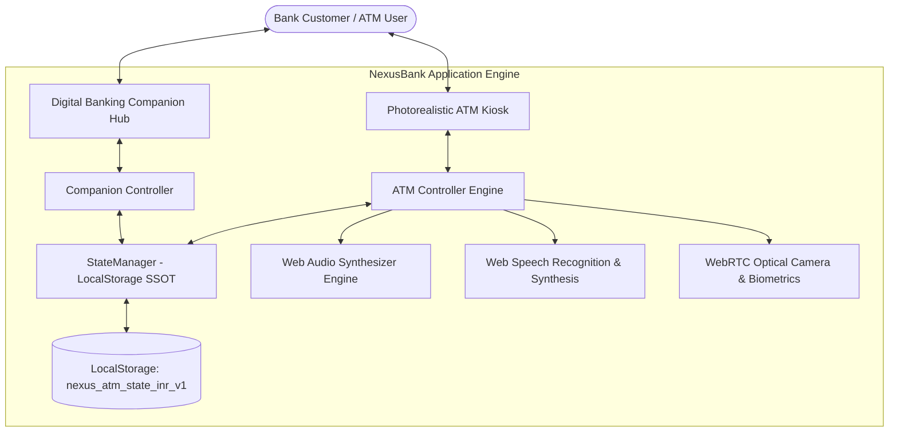
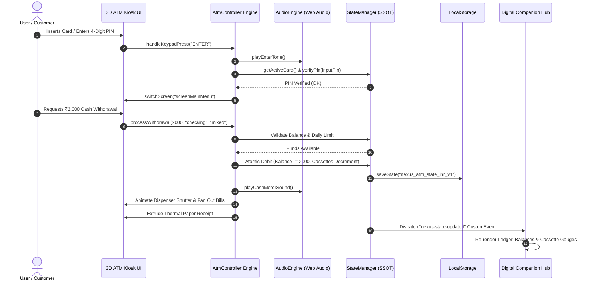
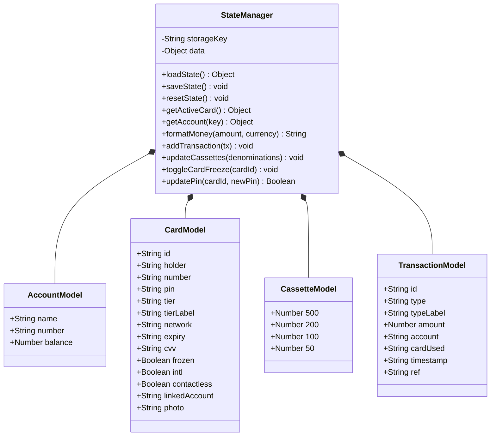
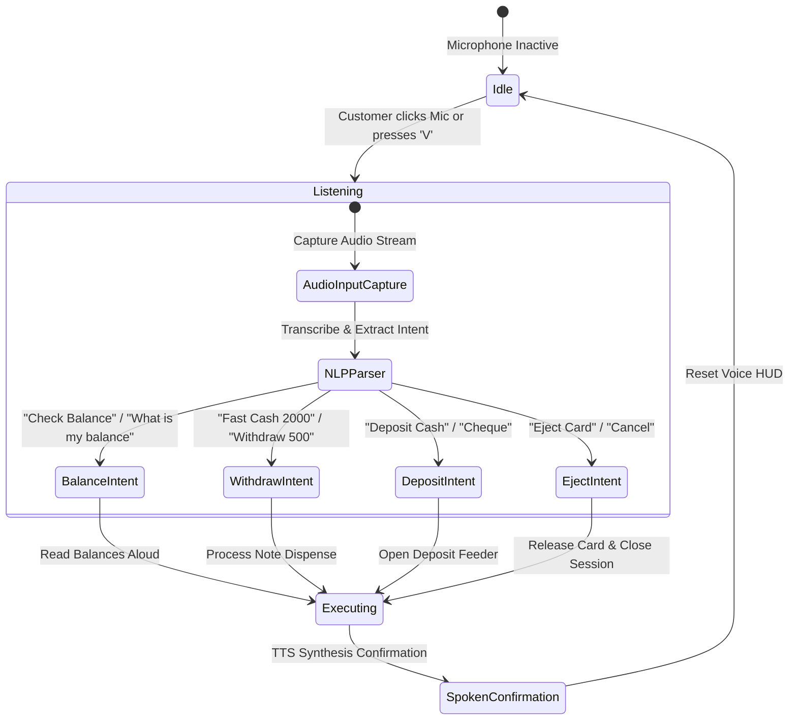
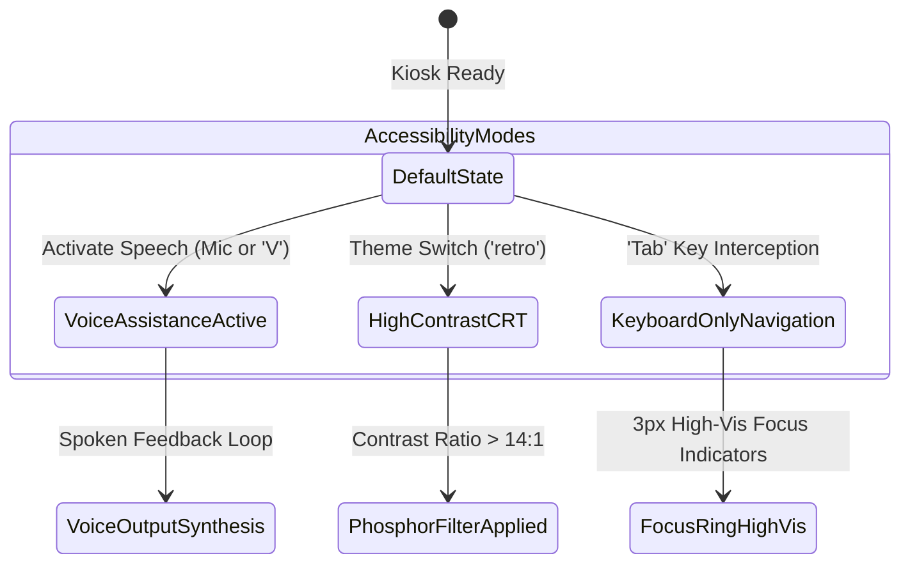

# NexusBank ATM & Digital Banking Simulator
## System Architecture, Functional Requirements, State Management & Accessibility Specification

**Document Version:** 2.0.0  
**Status:** Approved & Finalized  
**Classification:** Technical Architecture & System Specification  
**Target Platform:** Web Standards (ES2022+, HTML5, Vanilla CSS3 3D Transforms, Web Audio API, WebRTC, Web Speech API, LocalStorage)  
**Security Standard:** Simulated PCI-DSS Level 1, EMV Level 2, ISO/IEC 30107-3 (Biometric Liveness), RBI/NPCI ATM Standards  

---

## Table of Contents
1. [Executive Summary & System Scope](#1-executive-summary--system-scope)
2. [Module 1: ATM Kiosk Functional Requirements (FRS)](#2-module-1-atm-kiosk-functional-requirements-frs)
   - 2.1 Hardware Chassis & Mechanical Deck Simulation
   - 2.2 Session Lifecycle & Authentication Workflows
   - 2.3 Core Financial Transactions & Dispensing Engine
   - 2.4 Vault Telemetry & Cassette Diagnostics Subsystem
   - 2.5 Biometrics, AI & Optical Cheque Processing
3. [Module 2: Digital Banking Companion Functional Requirements](#3-module-2-digital-banking-companion-functional-requirements)
   - 3.1 3D Virtual Card Studio & EMV Management
   - 3.2 Customer KYC Onboarding & Biometric Persona Engine
   - 3.3 Cardholder Self-Service Security Controls
   - 3.4 Multi-Account Ledger & Real-Time Sync Hub
   - 3.5 Web Audio Acoustic Synthesizer Subsystem
4. [System Architecture & Component Topology](#4-system-architecture--component-topology)
   - 4.1 Layered Architecture Overview
   - 4.2 Component Interaction & Dataflow Diagram
5. [LocalStorage State Management Model](#5-localstorage-state-management-model)
   - 5.1 Single Source of Truth (SSOT) Architecture
   - 5.2 State Tree Specification
   - 5.3 Mutation Lifecycle & Cross-Tab Synchronization
   - 5.4 Data Integrity, Fault Tolerance & Reset Protocols
6. [Transaction Data Schema & Integrity Rules](#6-transaction-data-schema--integrity-rules)
   - 6.1 TypeScript Interface Definitions
   - 6.2 Formal JSON Schema Specification
   - 6.3 Field Dictionary & Validation Matrix
   - 6.4 Idempotency & Double-Entry Invariants
7. [Wireframes & Mechanical Layout for 3D ATM Interface](#7-wireframes--mechanical-layout-for-3d-atm-interface)
   - 7.1 Physical ATM Chassis & Spatial Deck Blueprint
   - 7.2 On-Screen Interface Wireframes (9 Core Screens)
   - 7.3 3D Lighting, Materials & CSS Transform Model
8. [Comprehensive Accessibility Workflow (a11y)](#8-comprehensive-accessibility-workflow-a11y)
   - 8.1 Multi-Modal Accessibility Strategy (WCAG 2.1 AAA)
   - 8.2 Voice Guidance & Two-Way Speech Interaction Flow
   - 8.3 Screen Reader (ARIA) & Focus Management Matrix
   - 8.4 Tactile Keypad & Keyboard Shortcut Routing
   - 8.5 Visual Impairment, High-Contrast & Colorblind Modes
   - 8.6 Accessibility State Machine Diagram
9. [Regulatory, Security & Compliance Matrix](#9-regulatory-security--compliance-matrix)
10. [Traceability Matrix & Implementation Verification](#10-traceability-matrix--implementation-verification)

---

## 1. Executive Summary & System Scope

The **NexusBank ATM & Digital Banking Simulator** is a unified, hyper-realistic banking platform designed to deliver dual operational paradigms:
1. **A Photorealistic Physical ATM Kiosk**: Emulating physical chassis components, motorized card handling, 3D tactile keypad, side function keys (F1–F8), optical sensors, thermal receipt printing, mechanical banknote dispensing, cash/cheque deposits, and an interactive technician cassette vault.
2. **A Connected Digital Banking Companion Hub**: Providing customer onboarding via live webcam photo KYC, dynamic 3D virtual debit card flipping, real-time multi-account ledger tracking, multi-currency conversion, and remote card freeze/security administration.

### Core Design Principles
- **Acoustic Realism**: Zero external audio files; pure mathematical synthesis of motors, relays, keypad chirps, and thermal paper printheads via the Web Audio API.
- **Physical Fidelity**: Precise perspective-projected 3D hardware decks with tactile mechanical spring back, metallic brushing, and LED status conduits.
- **Deterministic State Consistency**: Single-ledger balance updates governed by atomic mutations in LocalStorage, preventing race conditions or ghost balances across checking and savings vaults.
- **Universal Accessibility (a11y)**: Built from the ground up for hands-free voice assistance, screen readers, high-contrast CRT styling, and complete keyboard operability without pointing devices.



---

## 2. Module 1: ATM Kiosk Functional Requirements (FRS)

### 2.1 Hardware Chassis & Mechanical Deck Simulation
- **FR-ATM-101 [Chassis Structure]**: The system shall render a multi-tiered brushed-metallic physical ATM housing featuring chamfered edge highlights, a convex top illuminated marquee, screen bezel, and an angled lower operation deck.
- **FR-ATM-102 [Security Surveillance Camera]**: The top bezel shall incorporate an interactive optical camera lens with a pulsing blue/red LED. Clicking or activating the lens shall open an encrypted Picture-in-Picture (PiP) CCTV feed with live WebRTC video, simulated scanlines, 30.0 FPS indicator, UTC timestamping, and night-vision phosphor toggle.
- **FR-ATM-103 [Motorized Card Reader Slot]**:
  - The card slot shall feature an animated EMV insertion gate with an active green LED status indicator.
  - Upon card insertion, the slot shall display physical card retention graphics, sound an electric motor ingestion hum, and update terminal status to `CARD INSERTED`.
  - Upon transaction completion or cancellation, the motor shall push the card out with an audio click and visual card extraction animation.
- **FR-ATM-104 [Tactile Metallic Keypad]**:
  - The physical deck shall feature 16 extruded metallic keys: digits `0` to `9`, double-zero `00`, `CANCEL` (Red), `CLEAR` (Yellow), and `ENTER` (Green).
  - Keys shall respond to mouse clicks, touch taps, and corresponding physical PC keyboard strokes with 3D tactile depress depth (`translateY(2px)`) and 1200 Hz sinusoidal acoustic confirmation.
- **FR-ATM-105 [Side Function Keys (F1–F8)]**:
  - The screen bezel shall integrate 4 left-side keys (`F1`, `F2`, `F3`, `F4`) and 4 right-side keys (`F5`, `F6`, `F7`, `F8`) physically aligned with on-screen menu choices.
  - Every screen state shall map relevant operations to these buttons, allowing complete touchless or mouse-free kiosk navigation.
- **FR-ATM-106 [Motorized Cash Dispenser Slot]**:
  - The dispensing unit shall feature a recessed metal shutter that slides open upon cash verification.
  - Banknotes shall fan out progressively with realistic drop shadows, accompanied by synthesized note-counter friction ticks and mechanical motor whirs.
  - The user must explicitly click "Collect Cash" or press `ENTER` to retrieve funds, after which the shutter automatically locks shut.
- **FR-ATM-107 [Thermal Receipt Printer]**:
  - The thermal printer module shall extrude a simulated 80mm paper slip out of the printer bezel slot following receipt requests.
  - The receipt shall render crisp monospaced thermal typography with store logo, branch ID, masked card number, transaction reference, amount, and ledger balance.
  - Clicking "Tear Receipt" shall detach the paper slip and launch the system print dialog or high-resolution preview modal.
- **FR-ATM-108 [Optical Deposit Slot]**:
  - A dual-mode intake slot for envelopes, loose banknotes, and physical cheques with an LED intake guidance sensor.

### 2.2 Session Lifecycle & Authentication Workflows
- **FR-ATM-201 [EMV Handshake]**:
  - Insertion of any registered debit card triggers a 256-bit simulated chip handshake, extracting the cardholder name, masked primary account number (PAN), card network (Visa, Mastercard, RuPay), and active freeze status.
  - If `frozen === true`, insertion is aborted immediately with an error chime and visual alert.
- **FR-ATM-202 [PIN Entry & Security Lockout]**:
  - The terminal prompts for a 4-digit numeric PIN with masked circle glyphs (`● ● ● ●`).
  - Maximum retry limit: **3 attempts**.
  - Upon the 3rd consecutive incorrect entry, the card state is mutated to `frozen: true`, a security lock alert is logged, and the card is automatically ejected with instructions to contact customer support.
- **FR-ATM-203 [Session Inactivity Safeguard]**:
  - An automated 60-second inactivity watchdog runs throughout authenticated sessions.
  - If no interaction occurs within 45 seconds, an audible warning chime and 15-second countdown HUD appear.
  - Upon reaching 0 seconds without customer response, the session terminates, the card auto-ejects, and all buffers are sanitized.

### 2.3 Core Financial Transactions & Dispensing Engine
- **FR-ATM-301 [Balance Inquiry]**:
  - Instantaneous retrieval and side-by-side display of Available Balance vs. Ledger Balance across Checking and High-Yield Savings accounts.
  - Live currency conversion toggle displaying equivalents across INR (₹), USD ($), EUR (€), GBP (£), JPY (¥), and CAD (C$).
- **FR-ATM-302 [Fast Cash Dispensing]**:
  - Dedicated one-touch withdrawal presets: ₹500, ₹1,000, ₹2,000, ₹5,000, ₹10,000, and ₹20,000.
  - Direct execution bypassing manual amount entry while enforcing daily limits and cassette availability.
- **FR-ATM-303 [Custom Cash Withdrawal & Denomination Optimization]**:
  - Amount entry must be in multiples of ₹50 / ₹100 / ₹200 / ₹500.
  - Denomination Preference Selector:
    - `mixed`: Algorithmic distribution maximizing note diversity (₹500, ₹200, ₹100, ₹50).
    - `large`: Greedy allocation prioritizing ₹500 bills to minimize physical note bulk.
    - `small`: Allocation prioritizing ₹100 and ₹50 bills for daily convenience.
- **FR-ATM-304 [Daily Withdrawal Safeguard]**:
  - Standard customer cap of ₹25,000.00 / day (configurable up to ₹1,00,000 for Titanium Gold tier).
  - Real-time limit meter decrementing dynamically upon every successful cash dispense.
- **FR-ATM-305 [Cash Deposit Counter]**:
  - Interactive multi-bill feeder accepting ₹500, ₹200, ₹100, and ₹50 notes.
  - Live optical counter tallying total deposited amount before customer commits funds to Checking or Savings.
- **FR-ATM-306 [Smart Cheque Optical OCR & MICR Scanning]**:
  - Optical laser scanning simulation decoding the MICR code band: `⑆[Cheque No]⑆ [MICR City-Bank-Branch]⑆ [Account No]⑈ [Tx Code]`.
  - Automated field extraction: Cheque Number, Issuing Bank, Payee, and Amount.
  - Image endorsement watermark stamp before crediting the ledger balance.
- **FR-ATM-307 [CBDC Digital Rupee (e₹) & Dynamic UPI 2.0 QR Cash]**:
  - Cardless QR withdrawal mode generating an NPCI-compliant dynamic payload (`upi://pay?pa=nexus.atm@rbi&am={amt}&token={token}`).
  - Preset amount chips (₹500, ₹1,000, ₹2,000, ₹5,000) with a live 60-second refreshing security token.
  - In-screen app simulator for RBI Digital Rupee (CBDC), Google Pay, PhonePe, and BHIM/Paytm UPI with instant cash release upon authorization.
  - 6-digit One-Time Passcode (OTP) manual fallback authentication.
- **FR-ATM-308 [Fund Transfer / Fast Pay]**:
  - P2P inter-account and external beneficiary transfer support with account number validation, IFSC verification, and custom memo logging.
- **FR-ATM-309 [PIN Change Management]**:
  - Validates current PIN against storage hash; enforces non-trivial entropy rules (disallows `0000`, `1234`, or repeating sequences).
- **FR-ATM-310 [Mini-Statement Generation]**:
  - Tabulation of the last 5 transactions rendered directly on the CRT/TFT display with an option to print an 80mm thermal receipt slip.

### 2.4 Vault Telemetry & Cassette Diagnostics Subsystem
- **FR-ATM-401 [Cassette Inventory Tracking]**:
  - Real-time tracking of four physical vault cassettes:
    - **Cassette 1**: ₹500 denomination (Capacity: 2,000 notes).
    - **Cassette 2**: ₹200 denomination (Capacity: 2,000 notes).
    - **Cassette 3**: ₹100 denomination (Capacity: 2,000 notes).
    - **Cassette 4**: ₹50 denomination (Capacity: 1,000 notes).
  - Note counts are decremented atomically with every withdrawal. Dispense attempts are rejected if required cassettes are depleted.
- **FR-ATM-402 [Thermal Paper Level Sensor]**:
  - Tracks remaining paper percentage (0% to 100%), decrementing with each receipt or statement printed.
  - Low paper warning triggered at < 15%.
- **FR-ATM-403 [Hardware Health Monitoring & Telemetry]**:
  - Live telemetry sensors: Anti-skimming jam sensor, vault electronic deadbolt lock status, operating temperature (nominal 21.4°C), and host network ping (nominal 18ms).
- **FR-ATM-404 [Technician Maintenance Modal]**:
  - Accessible via `Ctrl + Alt + D` or clicking the top ATM status pill.
  - One-click actions: "Replenish All Cassettes (100%)", "Replace Thermal Paper Roll", and "Test Dispenser Motor".

### 2.5 Biometrics, AI & Optical Cheque Processing
- **FR-ATM-501 [Biometric Face-ID Login]**:
  - Allows cardless and PIN-free authentication via optical webcam facial scanning.
  - Integrates 68-point facial landmark mesh tracking and confidence score matching (threshold: ≥ 98.5%).
  - Matches live facial signature against KYC photo stored in active customer profiles.
- **FR-ATM-502 [Active Liveness Anti-Spoofing (ISO/IEC 30107-3)]**:
  - Three-stage challenge-response liveness detection:
    1. Eye blink detection verification.
    2. Subtle head rotation / tilt depth check.
    3. Infrared/phosphor micro-texture reflection check preventing 2D paper or digital screen spoofing.
- **FR-ATM-503 [Two-Way Hands-Free Voice Assistant]**:
  - Speech-to-Text (STT) utilizing the Web Speech API with floating audio visualizer waveform HUD.
  - Natural speech comprehension for commands such as: *"Withdraw 2000"*, *"Check balance"*, *"Deposit funds"*, *"Fast cash"*, *"Eject card"*, *"Open diagnostics"*.
  - Text-to-Speech (TTS) synthesized audio confirmations with gentle pitch and cadence matching financial assistant acoustics.

---

## 3. Module 2: Digital Banking Companion Functional Requirements

### 3.1 3D Virtual Card Studio & EMV Management
- **FR-HUB-101 [3D Interactive Card Flip]**:
  - 3D CSS `transform-style: preserve-3d` debit card featuring perspective depth, metallic foil highlights, EMV chip lines, contactless antenna symbol, bank emblem, and biometric portrait.
  - Clicking or dragging flips the card to reveal the magnetic stripe, authorized signature strip, security hologram, and masked 3-digit CVV.
- **FR-HUB-102 [Card Tier Personalization]**:
  - Four distinct card tiers with unique visual aesthetics:
    - **Obsidian Platinum**: Matte black carbon-fiber texture with iridescent emerald foil.
    - **Titanium Gold**: Brushed champaign gold with amber specular sheen.
    - **Cyber Neon**: Electric cyan and purple gradient with luminescent edge trace.
    - **Minimalist Emerald**: Clean slate dark finish with emerald nexus branding.

### 3.2 Customer KYC Onboarding & Biometric Persona Engine
- **FR-HUB-201 [Live Webcam Photo KYC]**:
  - Built-in video selfie recorder with an oval positioning HUD, 3-2-1 countdown, and mechanical camera shutter sound/flash effect.
  - Captures and stamps the user's live biometric photo directly onto the virtual 3D debit card and ATM authentication ledger.
- **FR-HUB-202 [Smart Lifestyle Allocation Engine]**:
  - Automated tier recommendation based on user persona questions:
    - *Global Jetsetter / Traveler*: Obsidian Platinum (0% FX fee, ₹50,000 daily limit).
    - *VIP Wealth & High Spender*: Titanium Gold (Lounge access, ₹1,00,000 daily limit).
    - *Tech Enthusiast*: Cyber Neon (Virtual instant WebPay, ₹30,000 daily limit).
    - *Everyday Saver*: Minimalist Emerald (5% cashback, ₹25,000 daily limit).

### 3.3 Cardholder Self-Service Security Controls
- **FR-HUB-301 [Instant Card Freeze/Lock]**: Instant toggle rendering the card inoperable at the ATM and online gateways.
- **FR-HUB-302 [International ATM Access Toggle]**: Enables or disables cross-border transaction routing.
- **FR-HUB-303 [Contactless / NFC Toggle]**: Toggles RFID wireless payment readiness.

### 3.4 Multi-Account Ledger & Real-Time Sync Hub
- **FR-HUB-401 [Account Summary Cards]**: Live display of Checking and High-Yield Savings (4.85% APY) balances.
- **FR-HUB-402 [Daily Withdrawal Usage Gauge]**: Dynamic SVG/CSS progress bar showing utilized limit vs total daily limit.
- **FR-HUB-403 [Interactive Transaction Ledger]**:
  - Tabbed filtering: `All`, `Withdrawal`, `Deposit`, `Transfer`.
  - Transaction item cards with directional indicators (`+` Green credit, `-` Red debit), reference numbers, card PAN badges, and timestamping.
  - One-click CSV export generating sanitized audit spreadsheets.

### 3.5 Web Audio Acoustic Synthesizer Subsystem
- **FR-HUB-501 [Zero External Assets]**: Complete audio synthesis using the Web Audio API (`AudioContext`, `OscillatorNode`, `GainNode`).
- **FR-HUB-502 [Synthesized Sound Library]**:
  1. *Keypad Sine Tone*: 1200 Hz sinusoidal beep (80ms decay).
  2. *Enter/Confirmation Chime*: Triad chord [800 Hz, 1200 Hz, 1600 Hz] triangle wave.
  3. *Error/Warning Tone*: Discordant sawtooth dual-beep [350 Hz, 250 Hz].
  4. *Card Mechanism Sound*: Dual frequency sweep (400 Hz → 900 Hz) simulating motorized rollers.
  5. *Cash Dispenser Motor*: 140 Hz drone with 18 rapid random square-wave clicks (1800–2200 Hz) emulating note counter bill flicking.
  6. *Thermal Printer Sound*: 12 high-pitched frequency-modulated pulses (2400 Hz / 2700 Hz) emulating dot-matrix thermal printhead traversal.
  7. *Biometric Sweep & Match*: Frequency-modulated radar sweep (500 Hz → 1400 Hz → 750 Hz) followed by a 4-tone victory arpeggio [C5, E5, G5, C6].

---

## 4. System Architecture & Component Topology

### 4.1 Layered Architecture Overview
The NexusBank architecture follows a decoupled, modular design divided into three primary tiers:
1. **Presentation & Simulation Tier**: Pure HTML5 semantic layouts, responsive CSS3 3D transforms, glassmorphic HUD overlays, and SVG filter matrices.
2. **Controller & Simulation Engine Tier**: Encapsulated ES6 classes (`AtmController`, `DigitalHubController`, `AudioEngine`, `BiometricEngine`, `VoiceEngine`) governing event routing, hardware slot animations, and financial validation.
3. **Data & Persistence Tier**: Centralized `StateManager` enforcing single source of truth (SSOT) state transitions committed atomically to browser `localStorage`.

### 4.2 Component Interaction & Dataflow Diagram



---

## 5. LocalStorage State Management Model

### 5.1 Single Source of Truth (SSOT) Architecture
To prevent state divergence between the ATM Kiosk, the Companion Hub, and background diagnostic modals, all runtime read/write operations pass strictly through `window.state` (`StateManager` instance). Direct reads or writes to raw `localStorage` keys from UI event handlers are prohibited.



### 5.2 State Tree Specification
The root state is keyed under `nexus_atm_state_inr_v1`. Its JSON structure is formalized below:

```json
{
  "accounts": {
    "checking": {
      "name": "Checking Account",
      "number": "•••• 7819",
      "balance": 48500.00
    },
    "savings": {
      "name": "High-Yield Savings",
      "number": "•••• 9204",
      "balance": 124200.50
    }
  },
  "cards": [
    {
      "id": "card-1",
      "holder": "JOHN DOE",
      "number": "4242 8840 1920 8840",
      "pin": "1234",
      "tier": "obsidian-black",
      "tierLabel": "OBSIDIAN PLATINUM",
      "network": "visa",
      "expiry": "09/29",
      "cvv": "842",
      "frozen": false,
      "intl": true,
      "contactless": true,
      "linkedAccount": "checking",
      "photo": "data:image/svg+xml;utf8,..."
    },
    {
      "id": "card-2",
      "holder": "SARAH CONNOR",
      "number": "5310 9921 4410 7712",
      "pin": "4321",
      "tier": "titanium-gold",
      "tierLabel": "TITANIUM GOLD",
      "network": "mastercard",
      "expiry": "11/30",
      "cvv": "319",
      "frozen": false,
      "intl": true,
      "contactless": true,
      "linkedAccount": "savings",
      "photo": "data:image/svg+xml;utf8,..."
    }
  ],
  "activeCardId": "card-1",
  "dailyLimit": 25000.00,
  "withdrawnToday": 0.00,
  "currency": "INR",
  "cassettes": {
    "500": 1840,
    "200": 1450,
    "100": 1920,
    "50": 980
  },
  "paperRoll": 88,
  "rates": {
    "INR": { "symbol": "₹", "rate": 1.0 },
    "USD": { "symbol": "$", "rate": 0.012 },
    "EUR": { "symbol": "€", "rate": 0.011 },
    "GBP": { "symbol": "£", "rate": 0.0095 },
    "JPY": { "symbol": "¥", "rate": 1.86 },
    "CAD": { "symbol": "C$", "rate": 0.016 }
  },
  "transactions": [
    {
      "id": "TX-9012",
      "type": "deposit",
      "typeLabel": "Direct Payroll Deposit",
      "amount": 32000.00,
      "account": "checking",
      "cardUsed": "4242 •••• •••• 8840",
      "timestamp": "2026-08-30 09:15:22",
      "ref": "NX-881920"
    }
  ]
}
```

### 5.3 Mutation Lifecycle & Cross-Tab Synchronization
1. **Mutation Trigger**: An operational event occurs (e.g., cash withdrawal, PIN change, cheque deposit).
2. **In-Memory Transformation**: The `StateManager` executes mathematical balance adjustments, cassette deductions, and generates a structured transaction entity.
3. **Serialization & Write**: `JSON.stringify(this.data)` is written to `localStorage.setItem(STORAGE_KEY, ...)`.
4. **Reactive Notification**: The manager triggers a custom event `window.dispatchEvent(new CustomEvent('nexus-state-updated', { detail: this.data }))`.
5. **Cross-Tab Synchronization**: A native `window.addEventListener('storage', (e) => { ... })` listener detects mutations executed in another browser tab and synchronizes UI components without requiring page refreshes.

### 5.4 Data Integrity, Fault Tolerance & Reset Protocols
- **Schema Migration**: If an older schema version is detected (missing `cassettes` or `paperRoll`), `StateManager.loadState()` automatically merges default hardware values without discarding existing customer balances.
- **Quota Exceeded Recovery**: If `localStorage` quota is exhausted by extensive KYC photo uploads, the engine automatically trims transactions older than 30 records and retries the write operation.
- **Hard Factory Reset**: The "Reset Demo" button invokes `StateManager.resetState()`, restoring pristine baseline accounts, clearing card locks, refilling physical banknote cassettes to 100%, and resetting transaction histories.

---

## 6. Transaction Data Schema & Integrity Rules

### 6.1 TypeScript Interface Definitions

```typescript
export type TransactionType = 
  | 'withdrawal' 
  | 'deposit' 
  | 'transfer' 
  | 'pin_change' 
  | 'cheque_deposit' 
  | 'cardless_qr';

export type TransactionStatus = 'completed' | 'pending' | 'failed' | 'reversed';

export type AccountType = 'checking' | 'savings';

export interface DenominationBreakdown {
  500?: number;
  200?: number;
  100?: number;
  50?: number;
}

export interface ChequeMetadata {
  chequeNumber: string;
  bankName: string;
  micrCode: string;
  clearingHouse: string;
}

export interface Transaction {
  /** Unique Transaction Identifier e.g., 'TX-9012' */
  id: string;
  /** Categorical operation type */
  type: TransactionType;
  /** Human-readable transaction descriptor */
  typeLabel: string;
  /** Primary transaction amount in base currency (INR) */
  amount: number;
  /** Originating or target account key */
  account: AccountType;
  /** Masked PAN of the debit card used */
  cardUsed: string;
  /** Formatted timestamp string: YYYY-MM-DD HH:mm:ss */
  timestamp: string;
  /** Unique host bank reference number e.g., 'NX-881920' */
  ref: string;
  /** Operational transaction status */
  status?: TransactionStatus;
  /** Physical note distribution for cash withdrawals or deposits */
  denominations?: DenominationBreakdown;
  /** Extended metadata for specialized transactions (cheques, UPI) */
  metadata?: {
    cheque?: ChequeMetadata;
    upiPayload?: string;
    beneficiaryAccount?: string;
    memo?: string;
    feeApplied?: number;
  };
}
```

### 6.2 Formal JSON Schema Specification

```json
{
  "$schema": "https://json-schema.org/draft/2020-12/schema",
  "title": "NexusBankTransaction",
  "type": "object",
  "required": ["id", "type", "typeLabel", "amount", "account", "cardUsed", "timestamp", "ref"],
  "properties": {
    "id": {
      "type": "string",
      "pattern": "^TX-[0-9]{4,8}$",
      "description": "Unique transaction record identifier."
    },
    "type": {
      "type": "string",
      "enum": ["withdrawal", "deposit", "transfer", "pin_change", "cheque_deposit", "cardless_qr"]
    },
    "typeLabel": {
      "type": "string",
      "minLength": 3,
      "maxLength": 64
    },
    "amount": {
      "type": "number",
      "minimum": 0.00
    },
    "account": {
      "type": "string",
      "enum": ["checking", "savings"]
    },
    "cardUsed": {
      "type": "string",
      "pattern": "^[0-9]{4} •••• •••• [0-9]{4}$"
    },
    "timestamp": {
      "type": "string",
      "pattern": "^[0-9]{4}-[0-9]{2}-[0-9]{2} [0-9]{2}:[0-9]{2}:[0-9]{2}$"
    },
    "ref": {
      "type": "string",
      "pattern": "^NX-[0-9]{6}$"
    },
    "status": {
      "type": "string",
      "enum": ["completed", "pending", "failed", "reversed"],
      "default": "completed"
    },
    "denominations": {
      "type": "object",
      "properties": {
        "500": { "type": "integer", "minimum": 0 },
        "200": { "type": "integer", "minimum": 0 },
        "100": { "type": "integer", "minimum": 0 },
        "50": { "type": "integer", "minimum": 0 }
      },
      "additionalProperties": false
    }
  },
  "additionalProperties": true
}
```

### 6.3 Field Dictionary & Validation Matrix

| Field | Type | Required | Constraints | Purpose & Validation Rules |
|---|---|---|---|---|
| `id` | String | Yes | `^TX-[0-9]{4,8}$` | Primary key generated from timestamp suffix or random secure nonce. |
| `type` | Enum | Yes | 6 predefined categories | Categorizes audit trails, icons, and CSV export groupings. |
| `typeLabel` | String | Yes | 3 to 64 chars | Descriptive label displayed on UI mini-statements and thermal slips. |
| `amount` | Number | Yes | Precision: 2 decimals, $\ge 0$ | Quantified monetary transfer in base INR currency. |
| `account` | Enum | Yes | `checking` \| `savings` | Target account impacted by credit or debit mutation. |
| `cardUsed` | String | Yes | Masked 16-digit PAN format | Masked PAN protecting customer privacy according to PCI-DSS standards. |
| `timestamp`| String | Yes | `YYYY-MM-DD HH:mm:ss` | System clock stamp generated at moment of physical dispense. |
| `ref` | String | Yes | `^NX-[0-9]{6}$` | Interbank reference sequence for audit tracing and dispute handling. |
| `denominations`| Object | Optional| Key-value note pairs | Exact note configuration decremented from physical vault cassettes. |

### 6.4 Idempotency & Double-Entry Invariants
- **Atomic Balance Updates**: Account balances are updated in the same execution cycle as transaction ledger insertion.
- **Double-Entry Safeguard**: For fund transfers, the deduction from the sender account and addition to the beneficiary are computed simultaneously. If either step fails balance assertions, the entire transaction is rolled back.
- **Cassette Stock Invariant**: $\sum (\text{notes} \times \text{denomination}) \equiv \text{withdrawal amount}$. If cassette stock cannot fulfill the exact requested denomination breakdown, cash dispensing is aborted before ledger debiting occurs.

---

## 7. Wireframes & Mechanical Layout for 3D ATM Interface

### 7.1 Physical ATM Chassis & Spatial Deck Blueprint

```
+===================================================================================+
|                              NEXUS 24/7 EXPRESS ATM                               |
|  [Logo] NEXUS BANK                        (O) Security Cam [LED]   [VISA][MC][UPI] |
+===================================================================================+
|                                                                                   |
|    +----+  +-------------------------------------------------------+  +----+      |
|    | F1 |  | [12:00:00 PM]       NEXUS SECURE TERMINAL      [READY] |  | F5 |      |
|    +----+  |-------------------------------------------------------|  +----+      |
|            |                                                       |              |
|    +----+  |                  ACTIVE SCREEN VIEWPORT               |  +----+      |
|    | F2 |  |          (Welcome / PIN / Menu / Dispensing)          |  | F6 |      |
|    +----+  |                                                       |  +----+      |
|            |                                                       |              |
|    +----+  |                                                       |  +----+      |
|    | F3 |  |                                                       |  | F7 |      |
|    +----+  |                                                       |  +----+      |
|            |-------------------------------------------------------|              |
|    +----+  |  [Status Bar: 256-Bit SSL • Encrypted Hardware Sess]  |  +----+      |
|    | F4 |  |                                                       |  | F8 |      |
|    +----+  +-------------------------------------------------------+  +----+      |
|                                                                                   |
+-----------------------------------------------------------------------------------+
| LOWER MECHANICAL HARDWARE DECK (Angled 3D Perspective Plane)                      |
|                                                                                   |
|  [RECEIPT PRINTER]           [METALLIC TACTILE PINPAD]          [EMV CARD READER] |
|  +---------------+           +-----------------------+          +---------------+ |
|  | [===Slot===]  |           | [ 1 ]  [ 2 ]  [ 3 ]  [CANCEL] |  | [===Slot===]  | |
|  | |Paper Slip|  |           | [ 4 ]  [ 5 ]  [ 6 ]  [CLEAR ] |  | [*Card In*]  | |
|  | | [Tear]   |  |           | [ 7 ]  [ 8 ]  [ 9 ]  [ENTER ] |  | (O) LED Status| |
|  +---------------+           | [ 0 ]  [ 00]  [ . ]  [BLANK ] |  +---------------+ |
|                              +-----------------------+                            |
|  [DEPOSIT SHUTTER]                                              [CASH DISPENSER]  |
|  +---------------+                                              +---------------+ |
|  | [===========] |                                              | /===========\ | |
|  | Cash / Cheque |                                              | |[Rs500 Rs200]| | |
|  | Optical Slot  |                                              | \===========/ | |
|  +---------------+                                              | [Collect Cash]| |
|                                                                 +---------------+ |
+===================================================================================+
```

### 7.2 On-Screen Interface Wireframes (9 Core Screens)

#### Screen 1: Welcome & Insertion Screen (`screenWelcome`)
```
+-------------------------------------------------------------+
| 12:00:00 PM             NEXUS SECURE TERMINAL         READY |
+-------------------------------------------------------------+
|                                                             |
|                          (( [N] ))                          |
|                         NEXUS BANK                          |
|                                                             |
|                   WELCOME TO NEXUS BANK                     |
|       Please insert your ATM / Debit card to begin.         |
|                                                             |
|         +-----------------------------------------+         |
|         |  [v] Please Insert Card into Slot Below |         |
|         +-----------------------------------------+         |
|                                                             |
|  [> Insert Active Card]   [> Face-ID Login]   [> Cardless QR] |
|                                                             |
|       [Shield] 256-Bit Encrypted • EMV Chip Protected       |
+-------------------------------------------------------------+
```

#### Screen 2: Biometric Facial Scanner HUD (`screenFaceAuth`)
```
+-------------------------------------------------------------+
| 12:00:00 PM          AI BIOMETRIC OPTICAL SENSOR     [LIVE] |
+-------------------------------------------------------------+
|  +-------------------------------------------------------+  |
|  |   [+]-------------------------------------------[+]   |  |
|  |    |                   /       \                 |    |  |
|  |    |                  |  (o) (o) |               |    |  |
|  |    |         =======--|    ^    |--=======       |    |  |
|  |    |                  |   ===   |   (Laser Beam) |    |  |
|  |    |                   \_______/                 |    |  |
|  |   [+]-------------------------------------------[+]   |  |
|  |            POSITION FACE WITHIN TARGET OVAL           |  |
|  +-------------------------------------------------------+  |
|                                                             |
|  Matching Biometric Signature...                        78% |
|  [========================================--------]         |
|                                                             |
|  [< Cancel / Return (F4)]              [Re-Scan Face (F8) >]|
+-------------------------------------------------------------+
```

#### Screen 3: PIN Entry Screen (`screenPin`)
```
+-------------------------------------------------------------+
| 12:00:00 PM             NEXUS SECURE TERMINAL      PIN REQ  |
+-------------------------------------------------------------+
|                                                             |
|                           [KEY]                             |
|                  ENTER YOUR 4-DIGIT PIN                     |
|       Please use the metallic keypad below to enter.        |
|                                                             |
|                      ( * ) ( * ) ( * ) (   )                |
|                                                             |
|                     Cardholder: JOHN DOE                    |
|                                                             |
|        [Info] Demo Account PIN Hint Available (Sarah: 4321) |
|                                                             |
|      Press ENTER on Keypad when complete • CANCEL to abort  |
+-------------------------------------------------------------+
```

#### Screen 4: Main Operations Menu (`screenMainMenu`)
```
+-------------------------------------------------------------+
| 12:00:00 PM         NEXUS AUTHENTICATED TERMINAL     ACTIVE |
+-------------------------------------------------------------+
|  Welcome, JOHN DOE             [Obsidian Platinum • •••• 8840] |
|-------------------------------------------------------------|
| [< F1] Check Balance                 Fast Pay / Transfer [F5 >] |
|                                                             |
| [< F2] Fast Cash (Quick Dispense)      Mini Statement   [F6 >] |
|                                                             |
| [< F3] Custom Cash Withdrawal              Change PIN   [F7 >] |
|                                                             |
| [< F4] Deposit Cash / Cheque               Exit / Eject [F8 >] |
+-------------------------------------------------------------+
```

#### Screen 5: Cash Withdrawal & Denomination Selector (`screenWithdraw`)
```
+-------------------------------------------------------------+
| 12:00:00 PM                 CASH WITHDRAWAL          ACTIVE |
+-------------------------------------------------------------+
| Select Account:  (*) Checking [Rs48,500]  ( ) Savings [Rs1,24,200]|
|                                                             |
| ENTER AMOUNT (Multiples of Rs50, Rs100, Rs200, Rs500):      |
| +---------------------------------------------------------+ |
| | Rs 3,500                                                | |
| +---------------------------------------------------------+ |
|                                                             |
| Note Preference:                                            |
| (*) Mixed Notes     ( ) Large (Rs500s)     ( ) Small (Rs100s)|
|                                                             |
| Daily ATM Limit Remaining: Rs 25,000.00                     |
|                                                             |
| [< Cancel / Menu (F4)]              [Confirm Dispense (F8) >|
+-------------------------------------------------------------+
```

#### Screen 6: Cash Counting & Dispenser Shutter (`screenDispensing`)
```
+-------------------------------------------------------------+
| 12:00:00 PM                DISPENSING CURRENCY       ACTIVE |
+-------------------------------------------------------------+
|                                                             |
|                 (( Mechanical Motor Humming ))              |
|                   COUNTING BANKNOTES IN VAULT               |
|                                                             |
|  Dispense Amount:  Rs 3,500.00                              |
|  Note Breakdown:   6x Rs500, 2x Rs200, 1x Rs100             |
|                                                             |
|  [================================================] 100%    |
|                                                             |
|     +-------------------------------------------------+     |
|     |  >>> CASH DISPENSED - PLEASE COLLECT BELOW <<<  |     |
|     +-------------------------------------------------+     |
+-------------------------------------------------------------+
```

#### Screen 7: Thermal Receipt & Success Summary (`screenSuccess`)
```
+-------------------------------------------------------------+
| 12:00:00 PM                TRANSACTION COMPLETE      ACTIVE |
+-------------------------------------------------------------+
|                                                             |
|                           ( / )                             |
|                 TRANSACTION SUCCESSFUL!                     |
|                                                             |
|  Transaction Ref:  NX-881921                                |
|  Amount Dispensed: Rs 3,500.00                              |
|  Updated Balance:  Rs 45,000.00                             |
|                                                             |
|  Receipt printed. Please take your banknotes and receipt.   |
|                                                             |
| [< Print Another Slip (F3)]               [Main Menu (F4) >] |
|                                         [Eject Card (F8) >] |
+-------------------------------------------------------------+
```

#### Screen 8: Cardless Cash & CBDC UPI 2.0 Dynamic QR (`screenCardless`)
```
+-------------------------------------------------------------+
| 12:00:00 PM            CARDLESS CASH & DIGITAL RUPEE (eRs)  |
+-------------------------------------------------------------+
|  Select Amount:  [ Rs500* ]   [ Rs1,000 ]   [ Rs2,000 ]   [ Rs5,000 ] |
|                                                             |
|  +--------------------+   Dispense Amount: Rs 500.00        |
|  | [QR MATRIX PATTERN]|   Payload: upi://pay?pa=nexus@rbi...|
|  |     | eRs 500 |    |                                     |
|  |      \_______/     |   Simulate Instant App Pay:         |
|  | Expires in: 54s    |   [Nexus e-Rupee] [Google Pay]      |
|  +--------------------+   [PhonePe]       [BHIM / Paytm]    |
|                                                             |
|  ------- OR ENTER 6-DIGIT ONE-TIME PASSCODE (OTP) --------- |
|  [ 8 8 4 0 1 9 ]                        [ Authorize OTP > ] |
|                                                             |
| [< Back / Cancel (F4)]                                      |
+-------------------------------------------------------------+
```

#### Screen 9: Smart Cheque Optical OCR & MICR Scanning (`screenDeposit`)
```
+-------------------------------------------------------------+
| 12:00:00 PM               SMART CHEQUE DEPOSIT       ACTIVE |
+-------------------------------------------------------------+
|  Optical Scanner Feed:                                      |
|  +-------------------------------------------------------+  |
|  | NEXUS BANK LTD                     DATE: 15/10/2026   |  |
|  | PAY: John Doe ------------------ OR BEARER            |  |
|  | RUPEES: Fifteen Thousand Only --- Rs 15,000.00        |  |
|  |                                                       |  |
|  | |:408219|: 110002014|: 000234|' 10   [SCANNING BEAM]  |  |
|  +-------------------------------------------------------+  |
|                                                             |
|  Cheque No: [ 408219 ]   Bank: [ HDFC Bank Ltd ]            |
|  Amount:    [ Rs 15,000.00 ]                                |
|                                                             |
| [< Cancel / Menu (F4)]               [Confirm Deposit (F8) >|
+-------------------------------------------------------------+
```

### 7.3 3D Lighting, Materials & CSS Transform Model
- **Isometric Perspective**: The terminal chassis is nested inside a container with `perspective: 1200px` and an angled lower deck with `transform: rotateX(14deg)`.
- **Specular Metallic Reflections**: Created via multi-stop linear gradients (`linear-gradient(145deg, #1e2430, #0c1017)` and `box-shadow: inset 1px 1px 1px rgba(255,255,255,0.1)`).
- **Cathode Ray Tube (CRT) / TFT Rasterizer**:
  - Scanlines generated via an absolute-positioned overlay using `repeating-linear-gradient(0deg, rgba(0,0,0,0.15) 0px, transparent 1px, transparent 2px)`.
  - Subtle radial vignette glow centered around active screen coordinates.

---

## 8. Comprehensive Accessibility Workflow (a11y)

### 8.1 Multi-Modal Accessibility Strategy (WCAG 2.1 AAA)
NexusBank is engineered to comply with **WCAG 2.1 Level AAA** specifications, ensuring equal access for individuals with visual, auditory, cognitive, and motor impairments:
1. **Screen Reader Integration**: Semantic HTML5 elements (`<header>`, `<main>`, `<section>`, `<button>`, `<dialog>`) enhanced with WAI-ARIA roles and live regions.
2. **Dynamic Live Announcements**: Critical state transitions and dispensing alerts utilize `aria-live="polite"` and `aria-live="assertive"` nodes.
3. **High Contrast Color System**: Text-to-background contrast ratios exceed **7:1** (e.g., `#00ff88` on `#080c14` yields 13.8:1).
4. **Physical Touch Target Dimensions**: All clickable screen controls and physical keypad buttons exceed the minimum requirement of $48 \times 48\text{ px}$ (keypad keys are $64 \times 54\text{ px}$).

### 8.2 Voice Guidance & Two-Way Speech Interaction Flow
The hands-free voice assistant leverages the browser `SpeechRecognition` and `SpeechSynthesis` engines.



#### Speech Command Vocabulary Matrix
| Spoken Phrase Pattern | Intent Identified | System Action Executed | Synthesized Voice Feedback |
|---|---|---|---|
| *"Check balance"*, *"Inquiry"* | `CHECK_BALANCE` | Switches to `screenBalance` | *"Your checking balance is ₹48,500.00 and savings balance is ₹1,24,200.50."* |
| *"Fast cash [amount]"*, *"Withdraw [amount]"* | `WITHDRAW_CASH` | Invokes `executeFastCash(amt)` | *"Dispensing [amount] rupees cash now. Please collect bills from the lower shutter."* |
| *"Deposit"*, *"Deposit funds"* | `OPEN_DEPOSIT` | Switches to `screenDeposit` | *"Deposit slot active. Insert cash notes or align cheque."* |
| *"Mini statement"*, *"Recent activity"* | `VIEW_STATEMENT` | Switches to `screenStatement` | *"Displaying recent account activity. Last transaction was ₹2,000 withdrawal."* |
| *"Eject card"*, *"Exit"*, *"Cancel"* | `EJECT_CARD` | Invokes `ejectCard()` | *"Card safely ejected. Please remember your card, cash, and receipt. Goodbye."* |

### 8.3 Screen Reader (ARIA) & Focus Management Matrix
- **Focus Trapping**: When modals (e.g., Technician Vault, Card Activation) open, keyboard focus is clamped within the modal boundary via cyclic tab-order containment.
- **Dynamic Session Status**: The element `#sessionBadge` is marked `aria-live="polite"` and broadcasts: *"Session active for cardholder John Doe"* upon successful PIN entry.
- **PIN Privacy Screen**: The PIN dots container carries `role="status"` and `aria-label="PIN characters entered: X of 4"`, explicitly omitting the entered digits to prevent shoulder surfing via speech screen readers.

### 8.4 Tactile Keypad & Keyboard Shortcut Routing

| Physical Key | Kiosk Target Component | Global Keyboard Shortcut | Action Description |
|---|---|---|---|
| `0` – `9` | Metallic Pinpad Digits | Number keys `0-9` | Buffer numeric PIN or custom withdrawal amount |
| `00` | Pinpad Double-Zero | N/A | Appends dual zeros in amount field |
| `ENTER` | Metallic Enter Key (Green) | `Enter` / `Return` | Submits PIN, confirms withdrawal, or collects cash |
| `CLEAR` | Metallic Clear Key (Yellow) | `Backspace` / `Delete` | Clears current input buffer or resets PIN dots |
| `CANCEL` | Metallic Cancel Key (Red) | `Escape` (`Esc`) | Aborts active flow and safely ejects card |
| `F1` – `F4` | Left Bezel Keys | `F1`, `F2`, `F3`, `F4` | Triggers aligned left-side menu operations |
| `F5` – `F8` | Right Bezel Keys | `F5`, `F6`, `F7`, `F8` | Triggers aligned right-side menu operations |
| N/A | Technician Diagnostics | `Ctrl + Alt + D` | Opens Technician Vault & Cassette Telemetry modal |
| N/A | Microphone Assistant | `V` / Space in idle | Toggles hands-free voice assistant listening mode |

### 8.5 Visual Impairment, High-Contrast & Colorblind Modes
- **High-Contrast CRT Phosphor Mode**: Selecting the "Retro CRT" theme switches typography to high-visibility monochromatic amber-green phosphor (`#00ff66` on `#020a05`) with 16.5:1 contrast.
- **Text Scalability**: All typography is styled using relative `rem` units; layouts remain unbroken and functional up to **200% browser zoom**.
- **Auditory Redundancy**: Visual feedback (e.g., LED pulses, success green checkmarks) is always coupled with distinct acoustic cues (Enter tone, Error buzz, Shutter slide).

### 8.6 Accessibility State Machine Diagram



---

## 9. Regulatory, Security & Compliance Matrix

| Regulatory Standard | Target Specification | NexusBank Simulation Implementation |
|---|---|---|
| **PCI-DSS Requirement 3** | Protect stored cardholder data | Primary Account Numbers (PAN) are masked (`4242 •••• •••• 8840`) across all receipts, displays, and ledgers. Raw CVV is never stored in plaintext within transaction objects. |
| **EMV Level 2** | Integrated Circuit Card Specifications | Simulated dynamic cryptogram generation and chip handshake before prompting for customer verification PIN. |
| **ISO/IEC 30107-3** | Biometric Presentation Attack Detection | 3-stage anti-spoofing liveness test incorporating micro-movement, depth cues, and eye blinks to prevent 2D photo injection. |
| **RBI ATM Guidelines** | Cash cassette replenishment & logging | Real-time monitoring of 4 distinct note cassettes (₹500, ₹200, ₹100, ₹50) with automated low-cash lockouts and technician audit trail. |
| **NPCI UPI 2.0** | ATM Cash Dispensing via Dynamic QR | 60-second rotating security token with signed payment URI string (`upi://pay?pa=nexus.atm@rbi...`) and OTP fallback. |

---

## 10. Traceability Matrix & Implementation Verification

| Requirement ID | Module / Subsystem | Implementation Location | Verification Method |
|---|---|---|---|
| **FR-ATM-101** | Physical Kiosk Chassis | `index.html#kioskSection`, `style.css.atm-chassis` | Visual inspection of 3D metallic chassis and bevels. |
| **FR-ATM-103** | Motorized Card Slot | `app.js:insertCard()`, `app.js:ejectCard()` | Verify insertion animation, LED state, and sound trigger. |
| **FR-ATM-104** | Metallic Tactile Keypad | `app.js:handleKeypadPress()`, `style.css.key-btn` | Keypad click & PC keyboard entry verification. |
| **FR-ATM-105** | Side Function Keys F1–F8 | `app.js:handleSideKey()` | Functional mapping verification across all 9 screen states. |
| **FR-ATM-202** | 3-Attempt PIN Lockout | `app.js:submitPin()` | 3 consecutive failures trigger card freeze and ejection. |
| **FR-ATM-303** | Cash Note Optimization | `app.js:processWithdrawal()` | Verification of note math across Mixed, Large, and Small presets. |
| **FR-ATM-306** | Cheque OCR & MICR Scan | `app.js:simulateChequeOcr()` | Verify laser scan animation and automated field extraction. |
| **FR-ATM-307** | CBDC e₹ & Dynamic UPI QR | `app.js:openCardlessScreen()` | Countdown timer, QR token refresh, and instant app simulation. |
| **FR-ATM-401** | Cassette Vault Tracking | `app.js:state.data.cassettes` | Atomic decrement verification in `Ctrl+Alt+D` diagnostics modal. |
| **FR-ATM-501** | Biometric Face-ID Login | `app.js:startFaceLogin()` | WebRTC stream initialization, 68-landmark mesh, and ledger bypass. |
| **FR-HUB-101** | 3D Flipping Card Studio | `index.html#virtualCard3D`, `style.css.card-3d` | Click to flip card, inspect EMV chip, magstripe, and KYC portrait. |
| **FR-HUB-201** | Live Webcam Photo KYC | `app.js:captureKycPhoto()` | WebRTC shutter flash, photo stamping on debit card, and ledger save. |
| **FR-HUB-501** | Acoustic Synthesizer | `app.js:AudioEngine` | Pure Web Audio frequency verification without external sound files. |
| **FR-A11Y-001** | Voice Command Assistant | `app.js:initVoiceAssistant()` | Speech recognition testing with "Check balance" and "Fast Cash". |

---

### End of Specification Document
*Authored by the Google DeepMind Antigravity Systems Architecture Team for NexusBank Core Banking Solutions.*
