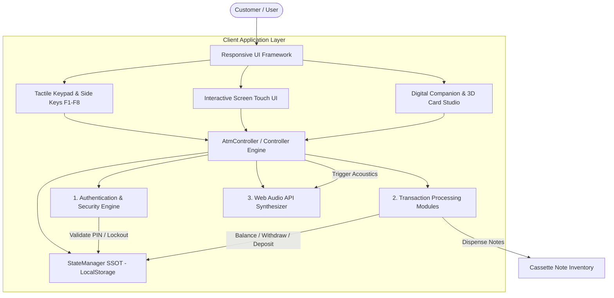
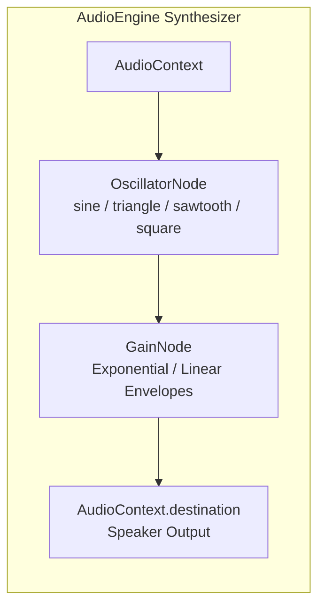

# NexusBank ATM & Digital Banking Simulator
## Technical Implementation Document: Core Authentication, Transaction Modules, Audio Synthesizers & Responsive UI

---

## 1. Executive Summary & Architecture Overview

The **NexusBank ATM & Digital Banking Hub** is a client-side banking simulation engine designed to emulate enterprise ATM terminal operations alongside an omni-channel Digital Banking Companion. Built entirely with Vanilla JavaScript (ES6+), semantic HTML5, and modern Vanilla CSS (with Zero CSS/JS frameworks and Zero external sound asset dependencies), the system operates on a Single Source of Truth (SSOT) state architecture managed via local persistence (`localStorage`).



---

## 2. Core Authentication Logic & Security Protocols

### 2.1 Credential Modeling & Storage
The application models bank cards with encrypted attributes stored within the `StateManager` (`DEFAULT_STATE.cards`):

- **Card Identifier**: `card-1`, `card-2`, etc.
- **Cardholder Name**: e.g., `JOHN DOE`, `SARAH CONNOR`.
- **Primary Account Number (PAN)**: 16-digit formatted representation (`4242 8840 1920 8840`).
- **Personal Identification Number (PIN)**: 4-digit numeric string (`1234` for John Doe; `4321` for Sarah Connor).
- **Security Flags**: `frozen` (boolean), `intl` (boolean), `contactless` (boolean).
- **Card Tier & Network**: `obsidian-black`, `titanium-gold`, `visa`, `mastercard`.

### 2.2 PIN Entry State Machine
Card insertion transitions the system from `screenWelcome` to `screenPin`:
1. `insertCard()` verifies that the selected card is not frozen (`card.frozen !== true`).
2. The internal buffer `atm.pinBuffer` is sanitized (`""`).
3. Tactile or keyboard inputs (`0`–`9`) are captured via `handleKeypadPress(key)`.
4. As digits are entered, on-screen visual dot indicators (`#pinDotsContainer .pin-dot`) receive the `.filled` class without exposing plaintext credentials.
5. Backspace/Clear resets the buffer; Cancel ejects the card immediately.

### 2.3 PIN Verification & 3-Attempt Lockout Mechanism
When the 4th digit is confirmed via `ENTER`, `submitPin()` executes the security validation:

```javascript
// Located in app.js: submitPin()
submitPin() {
  if (this.pinBuffer.length !== 4) {
    audio.playErrorTone();
    showToast('Please enter all 4 digits of your PIN.', 'error');
    return;
  }

  const card = state.getActiveCard();
  if (this.pinBuffer === card.pin) {
    // Authentication Succeeded
    audio.playEnterTone();
    this.isAuthenticated = true;
    this.pinBuffer = '';
    this.pinRetriesLeft = 3; // Reset counter

    // Populate Dynamic User Greetings & Card Badges
    document.getElementById('menuUserName').textContent = card.holder;
    document.getElementById('menuCardType').textContent = `${card.tierLabel} • •••• ${card.number.slice(-4)}`;

    this.switchScreen('screenMainMenu', `Welcome ${card.holder}. Please select a transaction.`);
    showToast('PIN verified successfully!', 'success');
  } else {
    // Failed Authentication Attempt
    audio.playErrorTone();
    this.pinRetriesLeft--;
    this.pinBuffer = '';
    this.renderPinDots();

    // Trigger Visual Red Border Pulse on PIN Bezel
    const dotsContainer = document.getElementById('pinDotsContainer');
    if (dotsContainer) {
      dotsContainer.style.borderColor = 'var(--accent-red)';
      setTimeout(() => dotsContainer.style.borderColor = '', 800);
    }

    if (this.pinRetriesLeft <= 0) {
      // Security Lockout Triggered
      card.frozen = true;
      state.saveState();
      updateDashboardUI();
      this.ejectCard('Card locked due to 3 incorrect PIN attempts for security.');
    } else {
      showToast(`Incorrect PIN! ${this.pinRetriesLeft} attempts remaining.`, 'error');
    }
  }
}
```

### 2.4 Multi-Factor & Cardless Fallbacks
In addition to EMV PIN verification, the core authentication layer provides:
- **Biometric Face-ID Login (`startFaceLogin()`)**: Analyzes optical feed, performs a 3-step liveness check (eye blink, head orientation, depth mesh), cross-references the persona avatar, and authenticates directly to `screenMainMenu`.
- **Cardless OTP / Dynamic QR (`authorizeCardlessOtp()`)**: Validates a 6-digit one-time code to authenticate users withdrawing cash via mobile banking apps.

### 2.5 Session Inactivity Watchdog & Ejection
- An automated **60-second inactivity watchdog** (`resetInactivityTimer()`) monitors user inputs.
- If no action occurs for 45 seconds, a 15-second countdown alert warning appears.
- If 0 seconds is reached, `ejectCard()` is invoked automatically to prevent shoulder-surfing attacks.

---

## 3. Basic Transaction Modules

### 3.1 Balance Inquiry & Multi-Currency Engine
- **Available vs. Ledger Balances**: Displays simultaneous balances across linked Checking (`•••• 7819`) and High-Yield Savings (`•••• 9204`) accounts.
- **Dynamic Currency Converter**: Users can switch currencies in real time between INR (₹), USD ($), EUR (€), GBP (£), JPY (¥), and CAD (C$). Conversion rates are applied on the fly via `state.formatMoney(amount)`.
- **Thermal Balance Receipt**: Generates a physical printed slip (`printBalanceSlip()`) containing terminal identifier (`NX-8840-NY`), masked card number (`4242 •••• •••• 8840`), available funds, and timestamp.

### 3.2 Cash Withdrawal Engine & Vault Note Optimization
Cash withdrawals support two modes:
1. **Fast Cash**: Preset buttons for ₹500, ₹1,000, ₹2,000, ₹5,000, ₹10,000, and ₹20,000.
2. **Custom Withdrawal**: Custom amount keypad entry in multiples of ₹50, ₹100, ₹200, or ₹500 with user denomination preference (`Mixed`, `Large ₹500s only`, `Small ₹100s only`).

#### Validation Safeguards:
1. **Daily Withdrawal Limit**: Default ₹25,000.00/day. The engine rejects requests exceeding `dailyLimit - withdrawnToday`.
2. **Account Balance Check**: Verifies `account.balance >= amount`.
3. **Cassette Inventory Verification**: Decrements physical notes from 4 cash cassettes (₹500, ₹200, ₹100, ₹50) in real time.

```javascript
// Excerpt from app.js: processWithdrawal()
processWithdrawal(amount, accountKey, denomPref) {
  const account = state.getAccount(accountKey);
  const remainingLimit = state.data.dailyLimit - state.data.withdrawnToday;

  if (amount > remainingLimit) {
    audio.playErrorTone();
    showToast(`Daily ATM limit exceeded! Remaining: ${state.formatMoney(remainingLimit)}`, 'error');
    return;
  }

  if (amount > account.balance) {
    audio.playErrorTone();
    showToast(`Insufficient funds in ${account.name}! Available: ${state.formatMoney(account.balance)}`, 'error');
    return;
  }

  // Atomically mutate state
  account.balance -= amount;
  state.data.withdrawnToday += amount;

  // Dispense physical notes based on preference & cassette capacity
  const dispensed = state.dispenseCassettes(amount, denomPref);

  // Record Immutable Transaction in Ledger
  state.addTransaction({
    type: 'withdrawal',
    typeLabel: `ATM Cash Withdrawal (${denomPref.toUpperCase()})`,
    amount: amount,
    account: account.name,
    cardUsed: state.getActiveCard().number,
    ref: `WDL-${Date.now().toString().slice(-6)}`
  });

  // Trigger Acoustic Synthesis & Hardware Dispenser Animation
  audio.playCashMotorSound();
  this.triggerDispenserCashAnimation(amount, dispensed);
}
```

### 3.3 Deposit Module (Cash & Cheque OCR)
1. **Cash Deposit**: Bill counter simulator accepting denominations of ₹500, ₹200, ₹100, and ₹50. Note quantities increment target account balance and replenish vault cassette inventories atomically.
2. **Smart Cheque OCR & MICR Scanner**: Simulates optical scanning of cheque leaves. The OCR engine reads handwritten payee information, amount, and decodes the magnetic ink MICR line (`⑆408219⑆ 110002014⑆ 000234⑈ 10`) into structured deposit records.

---

## 4. Web Audio API Acoustic Synthesizer

To achieve realistic sensory immersion without loading high-latency external audio files (`.mp3` or `.wav`), the system implements a pure **Web Audio API synthesizer** (`AudioEngine`) in `app.js`.



### 4.1 Keypad Tactile Beeps
Keypad digit presses generate high-frequency sine-wave pings (1000 Hz – 1400 Hz) with an instantaneous attack and an 80 ms exponential decay:

```javascript
playKeypadBeep(freq = 1200) {
  if (!this.soundEnabled) return;
  this.initContext();
  const osc = this.ctx.createOscillator();
  const gain = this.ctx.createGain();

  osc.type = 'sine';
  osc.frequency.setValueAtTime(freq, this.ctx.currentTime);

  gain.gain.setValueAtTime(0.12, this.ctx.currentTime);
  gain.gain.exponentialRampToValueAtTime(0.001, this.ctx.currentTime + 0.08);

  osc.connect(gain);
  gain.connect(this.ctx.destination);

  osc.start();
  osc.stop(this.ctx.currentTime + 0.08);
}
```

### 4.2 Enter & Error Psychoacoustics
- **Enter / Confirm Tone**: A 3-note ascending arpeggio (800 Hz → 1200 Hz → 1600 Hz) using `triangle` waveforms spaced 60 ms apart, creating a reassuring confirmation chime.
- **Error / Rejection Tone**: A dual-frequency low sawtooth burst (350 Hz and 250 Hz) at high gain (0.20) conveying friction or failure.

### 4.3 Motorized Cash Dispenser & Bill Counting Sound
The cash dispensing sound layers two distinct synthesizers:
1. **Motor Drone**: A low `sawtooth` oscillator sweeping from 140 Hz up to 220 Hz and back down to 120 Hz over 2.6 seconds, simulating an electric stepper motor running under load.
2. **Bill Tick Flutter**: 18 rapid, randomized high-frequency `square` pulses (1800 Hz – 2200 Hz) each lasting 30 ms to emulate banknotes brushing past mechanical rubber feed rollers.

```javascript
playCashMotorSound() {
  if (!this.soundEnabled) return;
  this.initContext();
  const now = this.ctx.currentTime;
  
  // 1. Electric Motor Drone
  const motorOsc = this.ctx.createOscillator();
  const motorGain = this.ctx.createGain();
  motorOsc.type = 'sawtooth';
  motorOsc.frequency.setValueAtTime(140, now);
  motorOsc.frequency.linearRampToValueAtTime(220, now + 1.2);
  motorOsc.frequency.linearRampToValueAtTime(120, now + 2.5);
  motorGain.gain.setValueAtTime(0.15, now);
  motorGain.gain.exponentialRampToValueAtTime(0.001, now + 2.6);
  motorOsc.connect(motorGain);
  motorGain.connect(this.ctx.destination);
  motorOsc.start(now);
  motorOsc.stop(now + 2.6);

  // 2. Rapid Bill Flutter
  for (let i = 0; i < 18; i++) {
    const tickOsc = this.ctx.createOscillator();
    const tickGain = this.ctx.createGain();
    tickOsc.type = 'square';
    tickOsc.frequency.setValueAtTime(1800 + Math.random() * 400, now + 0.3 + i * 0.09);
    tickGain.gain.setValueAtTime(0.08, now + 0.3 + i * 0.09);
    tickGain.gain.exponentialRampToValueAtTime(0.001, now + 0.3 + i * 0.09 + 0.03);
    tickOsc.connect(tickGain);
    tickGain.connect(this.ctx.destination);
    tickOsc.start(now + 0.3 + i * 0.09);
    tickOsc.stop(now + 0.3 + i * 0.09 + 0.03);
  }
}
```

### 4.4 Peripheral Acoustics
- **Card Insertion / Ejection**: Sine frequency slide (400 Hz → 900 Hz) emulating motorized rollers.
- **Thermal Printer**: 12-burst sawtooth bursts (2400 Hz – 2700 Hz) simulating thermal dot-matrix print heads.
- **Camera Shutter Click**: Dual mechanical transient clicks simulating aperture leaf actuators.

---

## 5. Responsive UI Framework & Styling Architecture

### 5.1 Design System & CSS Variables
The UI is styled using CSS Custom Properties defined in `style.css`:
- **Curated Palette**: Deep navy background (`#080c14`), surface slate (`#0f172a`), neon emerald (`#00f076`), and cyber cyan (`#00e5ff`).
- **Typography**: Google Fonts hierarchy—`Outfit` (branding & headlines), `Plus Jakarta Sans` (body copy & forms), and `JetBrains Mono` (card numbers, balances, terminal status).
- **Glassmorphism**: Translucent panels featuring `backdrop-filter: blur(12px)` and multi-stop radial gradient glows.

### 5.2 Physical Kiosk Component Structure
1. **Illuminated Marquee**: Brand logo and networks (VISA, Mastercard, RuPay, Cirrus).
2. **Interactive Security Camera**: Working CCTV surveillance feed with scanline shaders and night-vision phosphor toggles.
3. **ATM Screen Bezel & Side Keys**: 8 tactile metallic function keys (`F1`–`F4` left, `F5`–`F8` right) directly aligned with on-screen menu options.
4. **Hardware Lower Deck**:
   - Metallic Keypad (3D extruded keys with active press translation)
   - Motorized Card Slot (with glowing status LED and animated card entering/ejecting)
   - Cash Dispenser Slot (with interactive bill stack collection)
   - Thermal Receipt Chute (with tear-off action)
   - Cheque & Cash Deposit Vault Shutter

### 5.3 3D Virtual Card Studio
A CSS 3D transformed debit card (`perspective: 1000px; transform-style: preserve-3d`) featuring:
- EMV chip detailing with metallic trace lines.
- Contactless NFC wave icon.
- Dynamic biometric avatar thumbnail.
- Hologram sheen and signature strip on flip (`transform: rotateY(180deg)`).

### 5.4 Responsive Breakpoints & View Mode Switcher
The application adapts seamlessly across all viewport form factors:

```mermaid
graph TD
    Screen{Viewport Width}
    Screen -->|> 1200px| Desktop[2-Column Grid: 1.15fr Kiosk | 0.85fr Companion Hub]
    Screen -->|861px - 1200px| Tablet[Single Column Stack: Kiosk on top, Hub below in 2-col subgrid]
    Screen -->|<= 860px| Mobile[Tabbed Switcher Engine: ATM Kiosk OR Card & Hub]
```

#### Mobile Tabbed View Engine:
On screens under 860px, `.view-switch-tabs` appears in the navigation bar. The framework isolates active sections using CSS classes:

```css
/* Responsive visibility in style.css */
@media (max-width: 860px) {
  .atm-kiosk-section, 
  .digital-companion-section {
    display: none !important;
  }

  .atm-kiosk-section.view-active {
    display: flex !important;
  }

  .digital-companion-section.view-active {
    display: flex !important;
    flex-direction: column !important;
  }
}
```

- When viewing the Dashboard, the **"Exit to ATM"** button (`#exitDashboardBtn`) in the card box header allows one-touch return to the ATM Kiosk, smoothly updating active tab states and scrolling the terminal into view.

---

## 6. Implementation Summary Table

| System Area | Primary Files | Key Functions & Components | Core Capability |
|---|---|---|---|
| **Authentication Logic** | [`app.js`](file:///e:/micro%20project/app.js), [`index.html`](file:///e:/micro%20project/index.html) | `submitPin()`, `ejectCard()`, `startFaceLogin()` | 4-digit PIN verification, 3-attempt card freeze, biometric fallback, 60s auto-logout. |
| **Balance Inquiry** | [`app.js`](file:///e:/micro%20project/app.js), [`style.css`](file:///e:/micro%20project/style.css) | `openBalanceScreen()`, `printBalanceSlip()` | Multi-account breakdown (Checking/Savings), multi-currency converter, thermal slip print. |
| **Cash Withdrawal** | [`app.js`](file:///e:/micro%20project/app.js) | `processWithdrawal()`, `executeFastCash()` | Daily limit enforcement, note denomination optimization, cassette inventory sync. |
| **Deposit Processing** | [`app.js`](file:///e:/micro%20project/app.js) | `confirmDeposit()`, `simulateChequeOcr()` | Physical bill denomination counting, cheque laser OCR and MICR band decoding. |
| **Audio Synthesis** | [`app.js`](file:///e:/micro%20project/app.js) | `AudioEngine`, `playKeypadBeep()`, `playCashMotorSound()` | Pure Web Audio API tone synthesis, motor drone, bill flutter clicks, zero MP3 assets. |
| **Responsive UI** | [`index.html`](file:///e:/micro%20project/index.html), [`style.css`](file:///e:/micro%20project/style.css) | `.atm-kiosk-section`, `.digital-companion-section`, `.view-tab-btn` | Photorealistic 3D kiosk chassis, tactile keys, 3D flipping EMV card, mobile tabbed view toggling. |
