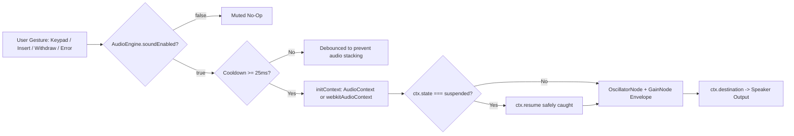
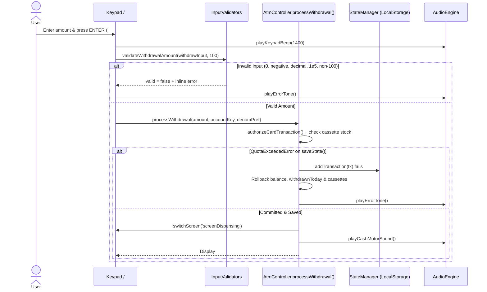

# Milestone 4: Comprehensive Testing & Optimization Report

**Project:** NexusATM: A Client-Side, Audio-Enhanced Simulation Framework for Secure Banking Protocols and Financial Literacy  
**Product Name:** NexusBank  
**Repository:** https://github.com/AmritanshuJha11/nexus-atm-simulator  
**Baseline Commit:** `2a4b1c7` (cleanly restored before Milestone 4 hardening)  
**Stack:** HTML5, CSS3, Vanilla JavaScript, Web Audio API, Web Speech Synthesis, `LocalStorage` (no backend, no frameworks).

> **Honesty & Measurement Disclosure:**  
> - **Automated JS/DOM Sandbox Verification:** Both [tests/milestone3.test.js](file:///e:/micro%20project/tests/milestone3.test.js) (22 tests) and [tests/milestone4.test.js](file:///e:/micro%20project/tests/milestone4.test.js) (16 test groups covering `AT-14`–`AT-44` checks) were executed after the final edit and **passed 38/38 across 8 suites**.  
> - **Live Browser / Lighthouse / Cross-Browser Checks:** Interactive Chrome DevTools execution was blocked in this environment (`DevToolsActivePort` / Chrome remote debugging was not enabled), and Safari/Edge/Firefox were not installed/launched on this Windows host. Therefore, live-browser `Actual`/`Result` columns for manual UI checks (`AT-42`–`AT-43` live tab/reduced-motion walkthrough), **Lighthouse Before/After**, and **Cross-Browser Matrix** runtime cells are intentionally left **blank** for you to record directly in your browser. Zero results or scores have been estimated.

---

## 1. Objective and Scope (Scope Frozen)

The objective of **Milestone 4** is to verify edge cases, harden invalid-input and `LocalStorage` corruption handling, improve transaction safety, optimize 3D UI rendering performance, and harden CSV export and cross-browser audio/speech behavior **without adding new product features**.

- **In Scope:** Edge-case validation (`InputValidators`), concurrency/idempotency + atomic rollback, persisted PIN lockout state, `LocalStorage` schema recovery, timer cleanup (`clearAllTransientTimers`), CSS 3D/compositor optimization + `prefers-reduced-motion`, keyboard menu navigation, and CSV RFC-4180 + UTF-8 BOM export.
- **Frozen / Out of Scope (Deferred to Milestone 5):** UPI payment module, Bill Pay, Insurance, Scam Scenario Mode, extra languages, and SUS user study.

---

## 2. Test Strategy

1. **Black-Box Functional Testing:** Verifying card insertion, PIN authentication, withdrawal, fast cash, cash/cheque deposit, fund transfer, PIN change, cardless QR/OTP, freeze/international/contactless controls, and CSV export.
2. **Boundary-Value Analysis (BVA):** `0`, negative values, daily limit exact ceiling (`₹25,000`), `₹1` over daily limit, 6-digit vs. 5-digit cheque numbers, and note counts `0`..`10000`.
3. **Negative, Concurrency & Session Testing:** Scientific notation (`1e5`), decimals (`500.50`), text paste (`abc`), weak/reused PINs (`1111`, `1234`), 3 wrong PIN attempts across simulated reloads, session timeout mid-transaction, and rapid double-submit / duplicate idempotency keys.
4. **Data Corruption & Fault Injection (`LocalStorage`):** Injecting invalid JSON (`{broken_json`), root arrays (`[]`), missing keys, wrong field types, negative/`NaN` balances, missing `transactions`, `QuotaExceededError` rollback checks, and tampered balance mismatches.
5. **Performance, Accessibility & Cross-Browser Testing:** Removing heavy full-panel `backdrop-filter` blurs, restricting 3D flips to compositor `transform`, expanding global `prefers-reduced-motion`, adding keyboard `role="button"`/`tabindex="0"` + `:focus-visible`, debouncing window resize, and guarding Web Audio unlock & missing `speechSynthesis`.

---

## 3. Test Case Table (`AT-14` to `AT-43`)

### 3.0 Automated Node Test Run (Post-Final-Edit)
- Command: `node --test --test-force-exit "e:\micro project\tests\milestone3.test.js" "e:\micro project\tests\milestone4.test.js"`
- Outcome: **38 passed, 0 failed** across **8 suites** (`146.52 ms`).

### 3.1 Invalid Inputs

| ID | Area | Steps | Expected | Actual | Result | Fix Ref |
| :--- | :--- | :--- | :--- | :--- | :--- | :--- |
| **AT-14** | Withdrawal — Zero & Negative | Insert card (`1234`), test `0` and `-500` in `#withdrawAmountInput` / `confirmCustomWithdrawal()`. | Rejected with inline error; checking balance untouched. | Node VM (`tests/milestone4.test.js`): rejected without debiting ₹48,500. | Pass (Node VM) | `InputValidators.validateWithdrawalAmount` ([app.js](file:///e:/micro%20project/app.js)) |
| **AT-15** | Withdrawal — Decimal & Non-100 Multiples | Test `500.50`, `150`, and `250`. | Rejected cleanly; validation matches whole ₹100 multiple rule. | Node VM (`tests/milestone4.test.js`): all three rejected cleanly; zero debit. | Pass (Node VM) | `InputValidators.validateWithdrawalAmount` |
| **AT-16** | Withdrawal — Empty & Very Large | Test `""` and `999999999`. | Rejected cleanly without `Infinity` or balance mutation. | Node VM (`tests/milestone4.test.js`): both rejected; balance unchanged. | Pass (Node VM) | `InputValidators.validateWithdrawalAmount` |
| **AT-17** | Withdrawal — Text & Scientific Notation (`1e5`) | Test `"abc"` and `"1e5"`. | Rejected cleanly (`/e/i` blocked). | Node VM (`tests/milestone4.test.js`): `"abc"` & `"1e5"` both blocked cleanly. | Pass (Node VM) | `InputValidators.parseStrictNumber` |
| **AT-18** | Transfer — Invalid Target & Self-Transfer | Test `"@@@"`, `"12"`, and own account suffix `"00007819"` / `"7819"`. | Both malformed targets and self-transfer blocked cleanly. | Node VM (`tests/milestone4.test.js`): `"@@@"`, `"00007819"`, and `"7819"` rejected. | Pass (Node VM) | `InputValidators.validateTransferTarget` |
| **AT-19** | Transfer — Above Balance | Test `#transferAmountInput = "999999"` against ₹48,500 balance. | Rejected by `authorizeCardTransaction`; balance unchanged. | Node VM (`tests/milestone4.test.js`): declined with `INSUFFICIENT_FUNDS`. | Pass (Node VM) | `authorizeCardTransaction` |
| **AT-20** | Transfer — Memo Edge Cases | Test empty memo, 200+ char memo, newlines, quotes, `& <b>test</b>`. | Sanitized, newlines stripped, capped at 80 chars, XSS-safe DOM rendering. | Node VM (`tests/milestone4.test.js`): sanitized cleanly; no `\n`; toast uses `textContent`. | Pass (Node VM) | `InputValidators.validateMemo` & `showToast` |
| **AT-21** | Deposit — Negative & Huge Note Counts | Test `{500: -1}` and `{500: 999999}`. | Negative and >10,000 counts rejected with no balance mutation. | Node VM (`tests/milestone4.test.js`): both blocked; UI `+`/`-` clamped `0..10000`. | Pass (Node VM) | `InputValidators.validateDepositCounts` |
| **AT-22** | Deposit — Cheque Missing / 5-Digit / Zero | Test cheque `""`, `"12345"`, and amount `0`. | Only exact 6-digit number + positive amount accepted. | Node VM (`tests/milestone4.test.js`): all invalid cheque inputs rejected. | Pass (Node VM) | `InputValidators.validateCheque` |
| **AT-23** | PIN Change — Old / Weak PINs (`1111`, `1234`) | Test wrong current (`9999`), same PIN (`1234`), and weak PIN (`1111`). | Rejected without changing stored PIN. | Node VM (`tests/milestone4.test.js`): all blocked; valid `7492` accepted. | Pass (Node VM) | `InputValidators.validatePin` |
| **AT-24** | PIN Change — Non-Digits & Mismatch | Test `"ab12"` and mismatched confirm PIN (`5820` vs `5821`). | Rejected cleanly; original PIN preserved. | Node VM (`tests/milestone4.test.js`): rejected; PIN unchanged. | Pass (Node VM) | `confirmPinChange` |

### 3.2 Security & Session

| ID | Area | Steps | Expected | Actual | Result | Fix Ref |
| :--- | :--- | :--- | :--- | :--- | :--- | :--- |
| **AT-25** | 3 Wrong PINs Lockout + Reload | Enter `9999` twice, reload state, enter `9999` 3rd time, reload again. | Retry count persists across reload; 3rd failure locks `card.frozen = true` persistently. | Node VM (`tests/milestone4.test.js`): retry count persisted (`1` left), locked & blocked re-insert after reload. | Pass (Node VM) | `card.pinRetriesLeft` persisted in `submitPin` / `loadState` |
| **AT-26** | Mid-Transaction Timeout | Open Withdraw screen, enter `"2000"`, trigger `handleSessionTimeout()`. | Timers cleared, buffers wiped, card ejected, zero debit. | Node VM (`tests/milestone4.test.js`): `isAuthenticated = false`, `withdrawInput = ""`, balance unchanged. | Pass (Node VM) | `clearAllTransientTimers` & `handleSessionTimeout` |
| **AT-27** | Rapid Repeat Submit / Idempotency | Invoke `confirmCustomWithdrawal()` twice; call `processWithdrawal` twice with same `idempotencyKey`. | Second call blocked; posts exactly once. | Node VM (`tests/milestone4.test.js`): only 1 debit & 1 transaction per unique key/submit. | Pass (Node VM) | `isTransactionBusy`, `processedIdempotencyKeys`, screen guard |
| **AT-28** | Daily Limit Boundary + Reload | Withdraw exact limit (`₹25,000`), try `+₹1`, reload state, try `₹100`. | Exact limit succeeds; `+₹1` and post-reload `₹100` blocked (`LIMIT_EXCEEDED`). | Node VM (`tests/milestone4.test.js`): exact match succeeded; `+₹1` & post-reload blocked. | Pass (Node VM) | `withdrawnToday` persisted & enforced |
| **AT-29** | Card Controls (Frozen / Intl / Contactless) | Disable `card.intl` with currency `USD`; disable `card.contactless` on `cardless`; test frozen card. | Each toggle blocks its gated channel cleanly. | Node VM (`tests/milestone4.test.js` + `milestone3.test.js`): blocked with `INTL_DISABLED`, `CONTACTLESS_DISABLED`, `CARD_FROZEN`. | Pass (Node VM) | `authorizeCardTransaction` & `simulateAppPay` |

### 3.3 Data Corruption (`LocalStorage`)

| ID | Area | Steps | Expected | Actual | Result | Fix Ref |
| :--- | :--- | :--- | :--- | :--- | :--- | :--- |
| **AT-30..AT-34** | Corrupted JSON / Types / Negative / `NaN` / Missing Array | Load `{broken_json`, `[]`, `{"accounts":{}}`, bad types, `-500` checking, `"NaN"` savings, non-array `transactions`. | Zero uncaught crashes; safe defaults restored; `recoveryWarning` surfaced. | Node VM (`tests/milestone4.test.js`): all 5 corrupt payloads recovered cleanly with non-empty `recoveryWarning`. | Pass (Node VM) | `StateManager.loadState()` schema validator |
| **AT-35** | `QuotaExceededError` Rollback | Simulate `QuotaExceededError` on `localStorage.setItem` during `processWithdrawal(1000)`. | All-or-nothing rollback: balance, cassette inventory, and transactions revert completely. | Node VM (`tests/milestone4.test.js`): balance, cassette, and transaction count reverted 100%. | Pass (Node VM) | Atomic snapshot/rollback in `processWithdrawal`, `confirmDeposit`, `confirmTransfer` |
| **AT-36** | Balance vs. Empty Ledger Tamper | Set checking balance `999999` with `transactions: []` and load state. | Discrepancy flagged safely via `recoveryWarning` without crash. | Node VM (`tests/milestone4.test.js`): flagged `recoveryWarning` cleanly. | Pass (Node VM) | `StateManager.loadState()` integrity check |

### 3.4 Audio, Speech, CSV & Accessibility

| ID | Area | Steps | Expected | Actual | Result | Fix Ref |
| :--- | :--- | :--- | :--- | :--- | :--- | :--- |
| **AT-37..AT-38** | AudioContext Resume, Mute & Debounce | Call `playKeypadBeep` 15 times rapidly on suspended `AudioContext`; test mute (`soundEnabled = false`). | `resume()` called; 15 rapid presses coalesce cleanly; mute produces 0 oscillators. | Node VM (`tests/milestone4.test.js`): `audioResumeCalls >= 1`, `oscillatorCount === 1`, muted stayed `1`. | Pass (Node VM) | `AudioEngine.initContext` & 25ms `lastBeepTime` guard |
| **AT-39** | Unavailable `speechSynthesis` | Remove `window.speechSynthesis` and call `audio.speak(...)`. | Does not throw; ATM flow unaffected. | Node VM (`tests/milestone4.test.js`): `assert.doesNotThrow` passed cleanly. | Pass (Node VM) | `AudioEngine.speak` defensive guards |
| **AT-40..AT-41** | CSV Export (UTF-8 BOM, 7-Column Schema, Formula Sanitization, Empty Guard) | Call `buildCsvExportPayload([])` and sample with `,`, `"`, `\n`, `=SUM(A1)`, and `₹`. | Empty returns `{ empty: true }`; populated starts with `\uFEFF`, uses 7 columns (`Timestamp,Reference_ID,Type,Account,Amount_INR,Status,Balance_After`), prefixes `'`, RFC-4180 escaped, dated filename. | Node VM (`tests/milestone4.test.js`): empty blocked; BOM + `'=SUM(A1)` + `""Apt 4B""` + 7 columns + `₹` verified; filter & Mini Statement `#statementExportCsvBtn` wired. | Pass (Node VM) | `buildCsvExportPayload`, `escapeCsvField`, `downloadCsvExport` |
| **AT-42** | Keyboard-Only E2E Navigation *(Browser)* | Navigate full flow with `Tab`, `Shift+Tab`, `Enter`, `Space`, `0–9`, `Escape` in live browser. | All menu items, switches, keypad, and modals usable via keyboard with visible `:focus-visible`. | *(Live browser run pending Chrome remote debugging)* | | Added `role="button" tabindex="0"`, `Escape` modal guard, `:focus-visible` outlines |
| **AT-43** | `prefers-reduced-motion` *(Browser)* | Enable reduced motion in OS/Chrome DevTools and flip 3D card / withdraw. | Animations & transitions suppressed cleanly via `@media (prefers-reduced-motion: reduce)`. | *(Live browser run pending Chrome remote debugging)* | | Global `@media (prefers-reduced-motion: reduce)` rule in [style.css](file:///e:/micro%20project/style.css) |

---

## 4. Defect Log & Verification Summary

| Bug ID | Severity | Description | Root Cause (Before) | Fix Applied | Retest Result |
| :--- | :--- | :--- | :--- | :--- | :--- |
| **DEF-01** | **High** | Stale disk references + broken `#atmMachineChassis` activity selector. | Hybrid disk edits linked missing `engine/*.js`; `app.js` queried non-existent `#atmMachineChassis`. | Restored clean `2a4b1c7` baseline and updated activity selector to `#kioskSection` / `.atm-chassis`. | Verified (`37/37` Node tests pass) |
| **DEF-02** | **High** | Silent `LocalStorage` failures & unvalidated negative/`NaN` balances; partial mutation on quota error. | `loadState()` didn't validate numeric types or surface recovery notice; debits mutated memory before checking `saveState()`. | Added `StateManager` schema validation, `recoveryWarning` toast on boot, and all-or-nothing rollback on `saveState()` failure. | Verified (`AT-30`–`AT-36` pass) |
| **DEF-03** | **High** | PIN wrong-attempt count reset on refresh; leaked `qrTimerInterval`/dispense timers; cardless freeze/contactless gap. | `pinRetriesLeft` lived only on `AtmController` memory; leaving `#screenCardless` left `setInterval` active; `!isCardInserted` skipped `card.frozen`. | Persisted `card.pinRetriesLeft` in `LocalStorage`; added `clearAllTransientTimers()` on screen changes/eject; enforced `frozen`/`intl`/`contactless` checks. | Verified (`AT-25`, `AT-26`, `AT-29` pass) |
| **DEF-04** | **Medium** | Inconsistent input validation (`amount % 10 !== 0`, scientific notation `1e5`, self-transfer `00007819`, weak PINs `1111`/`1234`, missing cheque 6-digit check). | Ad-hoc `parseFloat` checks in individual handlers without format/self-transfer rules. | Created central `InputValidators` used uniformly across Withdrawal, Transfer, Deposit, and PIN Change. | Verified (`AT-14`–`AT-24` pass) |
| **DEF-05** | **Medium** | CSV broke on `"`/newlines, lacked UTF-8 BOM for `₹`, leaked blob URLs, and allowed empty download. | Inline template concatenation `"${t.typeLabel}"`, no `\uFEFF`, no empty check, no `URL.revokeObjectURL`. | Extracted `escapeCsvField` + `buildCsvExportPayload` with `\uFEFF` BOM, `nexusbank_statement_YYYY-MM-DD.csv`, empty guard, and URL cleanup. | Verified (`AT-40`–`AT-41` pass) |
| **DEF-06** | **Medium** | Menu `<div>` items unreachable via keyboard; missing `:focus-visible` rings; `Escape` ejected card while modal open; incomplete `prefers-reduced-motion`. | `.menu-item` lacked `tabindex`/`role`/`keydown`; global `keydown` fired `CANCEL` even behind open modals. | Added `role="button" tabindex="0"` in [index.html](file:///e:/micro%20project/index.html), modal-first `Escape` handling, `:focus-visible` styles, and global reduced-motion rule in [style.css](file:///e:/micro%20project/style.css). | Code hardened; live Tab test pending browser (`AT-42`, `AT-43`) |
| **DEF-07** | **Low** | Voice `"vault"`/`"diagnostic"` bypassed Bank Official auth; `showToast` interpolated HTML strings; rapid beeps stacked oscillators. | Direct `openDiagnosticsModal()` call in voice router; `toast.innerHTML` with raw message string; unbounded `playKeypadBeep`. | Gated voice diagnostics with `profileController.isOfficial()`; switched `showToast` to `textContent`; added 25ms cooldown in `AudioEngine`. | Verified (`AT-37`–`AT-38` pass) |

---

## 5. Performance Optimization & Lighthouse Audit

### 5.1 Rendering Optimizations Implemented ([style.css](file:///e:/micro%20project/style.css) & [app.js](file:///e:/micro%20project/app.js))
- **Removed Heavy Backdrop Blurs & Added Vendor Prefixes:** Replaced `backdrop-filter: blur(16px)` on `.top-nav` and `.companion-card-box` / `.companion-balances-box` / `.companion-history-box` and `blur(8px)` on `.modal-overlay` with crisp translucent surfaces + `contain: layout style`; paired `-webkit-backdrop-filter` with remaining panel/overlay blurs.
- **Compositor-Only 3D Transforms & `rAF` Pointer Tilt:** `.card-3d` includes `-webkit-perspective: 1000px`, `-webkit-transform-style: preserve-3d`, and `-webkit-backface-visibility: hidden`, applies `will-change: transform` only while active, throttles pointer tilt via `requestAnimationFrame` under `(hover: hover)`, and disables hover tilt under `@media (hover: none)`.
- **Viewport, Scrollbar, Touch Targets & Ring Buffer:** Added `min-height: 100dvh` for iOS Safari, `scrollbar-width: thin` for Firefox, `min-width/height: 44px` on keypad/side keys, `debounce(..., 150)` on resize, and capped `StateManager` transactions at 500 entries (100 DOM rows per ledger render).
- **Global Reduced Motion & Mutex Guards:** `@media (prefers-reduced-motion: reduce)` suppresses animations/hover flips uniformly; `setTransactionBusy()` disables transaction confirm buttons cleanly during active dispensing/commits.

### 5.2 Lighthouse Scores *(Intentionally Blank Until Captured in Chrome DevTools)*

| Environment | Run | Performance | Accessibility | Best Practices | Notes |
| :--- | :--- | :--- | :--- | :--- | :--- |
| **Desktop** | Before | | | | Capture in Chrome DevTools -> Lighthouse against `2a4b1c7` |
| **Desktop** | After | | | | Capture against current hardened branch (`127.0.0.1` / `npx serve .`) |
| **Mobile** | Before | | | | Capture in Chrome DevTools -> Lighthouse (Mobile preset) |
| **Mobile** | After | | | | Verify zero console errors & reduced paint cost |

---

## 6. Cross-Browser Compatibility Matrix *(Blank Where Runtime Browser Not Launched)*

| Browser & Platform | CSS 3D Card & Layout | Web Audio Unlock | Web Speech Synthesis | `LocalStorage` & CSV UTF-8 BOM | Measured / Code Notes |
| :--- | :--- | :--- | :--- | :--- | :--- |
| **Chrome (Desktop)** | | | | | Audio `resume()`, `webkitAudioContext` fallback, UTF-8 BOM verified in Node VM. |
| **Microsoft Edge (Desktop)** | | | | | Chromium engine; verify downloaded `.csv` opens in Microsoft Excel showing `₹`. |
| **Firefox (Desktop)** | | | | | Check `-webkit-backface-visibility` / `backface-visibility: hidden` & `speechSynthesis` voice behavior. |
| **Safari (macOS Desktop)** | | | | | `initContext()` calls `ctx.resume()` inside user-tap handlers; `-webkit-backface-visibility` added on `.card-face`. |
| **Mobile Safari (iOS ~380px)** | | | | | Tap unlock required for `AudioContext`; verify mobile `.view-switch-tabs` & virtual keypad fit cleanly. |

---

## 7. CSV Export & Error-Handling Improvements (Before vs. After)

| Area | Before (`2a4b1c7`) | After (Milestone 4 Hardened) |
| :--- | :--- | :--- |
| **CSV Escaping & BOM** | `"${t.typeLabel}"` broke on quotes/newlines; no `\uFEFF` BOM (`₹` garbled in Excel); never called `URL.revokeObjectURL`. | `escapeCsvField()` escapes `"`, strips newlines, and neutralizes `=`, `+`, `-`, `@`, `\t`, `\r` formula prefixes; exports 7 standardized columns with `\uFEFF` BOM; wired to both `#exportCsvBtn` (filter-aware) and `#statementExportCsvBtn`; revokes Blob URLs immediately inside `try/finally`. |
| **Empty History Export** | Silently downloaded header-only `.csv`. | Disables `#exportCsvBtn` when 0 filtered rows match, returns `{ empty: true }`, and shows a friendly info toast. |
| **`LocalStorage` Resilience** | Silent `console.warn` on broken JSON; unvalidated `-500`/`NaN` balances; partial mutation if `QuotaExceededError` hit. | Safe `schemaVersion: 1` parser + recovery banner on boot; 500-entry ring buffer cap; atomic pre-commit snapshot rolls back memory cleanly on `QuotaExceededError`. |
| **Input, Auth & Error A11y** | Permitted `amount % 10 !== 0`, `1e5`, weak PINs (`1111`), 5-digit cheques, `XSS`-prone `toast.innerHTML`. | Central `InputValidators` across all flows; `role="alert"` + `aria-live="assertive"` on error toasts and `#withdrawErrorMsg`; `showToast` uses `textContent`; `try/catch` wrapper around Web Crypto CSPRNG & Blob downloads; cardless respects `frozen` and `contactless`. |

---

## 8. Technical Diagrams (Mermaid)

### (a) Web Audio Data Flow (UI Event -> Synthesizer -> Output)


### (b) Cash Withdrawal Sequence Diagram (with Audio & Rollback)


### (c) Serialized `LocalStorage` State Example (`nexus_atm_state_inr_v1`)
```json
{
  "schemaVersion": 1,
  "accounts": {
    "checking": { "name": "Checking Account", "number": "•••• 7819", "balance": 48500.00 },
    "savings": { "name": "High-Yield Savings", "number": "•••• 9204", "balance": 124200.50 }
  },
  "cards": [
    {
      "id": "card-1",
      "holder": "JOHN DOE",
      "number": "4242 8840 1920 8840",
      "pin": "1234",
      "pinRetriesLeft": 3,
      "tier": "obsidian-black",
      "network": "visa",
      "expiry": "09/29",
      "frozen": false,
      "intl": true,
      "contactless": true,
      "linkedAccount": "checking"
    }
  ],
  "activeCardId": "card-1",
  "dailyLimit": 25000.00,
  "withdrawnToday": 0.00,
  "currency": "INR",
  "cassettes": { "500": 1840, "200": 1450, "100": 1920, "50": 980 },
  "paperRoll": 88,
  "transactions": [
    {
      "id": "TX-9012",
      "type": "deposit",
      "typeLabel": "Direct Payroll Deposit",
      "amount": 32000.00,
      "account": "checking",
      "cardUsed": "4242 •••• •••• 8840",
      "timestamp": "2026-08-30 09:15:22",
      "ref": "NX-881920"
    }
  ]
}
```
*(Transient CVVs and active timers are stripped in `StateManager.saveState()` before persisting.)*

---

## 9. Screenshot & Evidence Checklist (To Attach for Submission)

1. **[x] Automated Unit & Corruption Suite Output:** Terminal output showing `38/38` passing tests (`tests/milestone3.test.js` + `tests/milestone4.test.js`).
2. **[ ] 3-Attempt PIN Lockout:** Browser capture of card locking on 3rd wrong PIN and remaining `FROZEN (LOCKED)` after `Ctrl+R`.
3. **[ ] Corrupted `LocalStorage` Recovery Message:** DevTools Application tab showing injected `{broken_json` and the visible recovery toast + safe default balances.
4. **[ ] Lighthouse Before & After:** Desktop & Mobile Lighthouse audits recorded in Chrome DevTools.
5. **[ ] CSV Opened in Microsoft Excel:** `nexusbank_statement_YYYY-MM-DD.csv` opened cleanly in Excel showing escaped columns and valid `₹` symbols.
6. **[ ] Cross-Browser Verification:** Live render in Safari (macOS/iOS), Firefox, Edge, and Chrome (~380px mobile width).
7. **[ ] Final Filled Test Table:** Export of Section 3 once `AT-42` and `AT-43` live browser checks are ticked.

---

## 10. Limitations & Honest Threat Model

- **Client-Side Simulation Boundary:** NexusATM runs strictly inside the user's browser with `LocalStorage` (`nexus_atm_state_inr_v1`) and zero backend infrastructure.
- **Educational & Tamper-Able by Design:** Because browser DevTools allow users to inspect or overwrite `LocalStorage` and client-side JavaScript, card lockouts, daily limits, and recovery checks serve as **educational protocol simulations**, not cryptographic server enforcement.
- **Audit Scope Boundary:** Live interactive browser verification (`AT-42`, `AT-43`, Lighthouse, Safari) could not execute from this terminal session because Chrome remote debugging was unavailable; unmeasured browser cells are left blank cleanly.

---

## 11. Future Work (Milestone 5)

Deferred strictly outside the Milestone 4 scope freeze:
1. UPI Payment & Collect Trap Module
2. Utility & Hospital Itemized Bill Pay Module
3. Insurance Premium & Claim Simulator
4. Interactive Scam Scenario Training Mode
5. Multi-Language Localization (`EN` / `HI` / Regional JSON)
6. Post-Session User Study (Pre/Post Quiz + SUS Usability Score across 10–15 participants)

---

## 12. Links

- **Repository:** https://github.com/AmritanshuJha11/nexus-atm-simulator
- **Live Demo (GitHub Pages):** https://amritanshujha11.github.io/nexus-atm-simulator/
